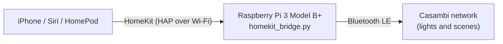

<a id="readme-top"></a>

<!-- PROJECT SHIELDS -->
[![Contributors][contributors-shield]][contributors-url]
[![Forks][forks-shield]][forks-url]
[![Stars][stars-shield]][stars-url]
[![Issues][issues-shield]][issues-url]
[![MIT License][license-shield]][license-url]

<!-- PROJECT HEADER -->
<br />
<div align="center">
  <h1 align="center">Casambi HomeKit Bridge</h1>

  <p align="center">
    Control your Casambi lighting scenes with Siri and the Apple Home app, with no Home Assistant needed.
    <br />
    A small Python service that runs on a Raspberry Pi and turns every Casambi scene into a HomeKit switch.
  </p>

  <p align="center">
    <a href="https://www.python.org/"></a>
    <a href="https://casambi.com/"></a>
    <a href="https://developer.apple.com/homekit/"></a>
    <a href="https://www.raspberrypi.com/products/raspberry-pi-3-model-b-plus/"></a>
    <a href="https://www.bluetooth.com/"></a>
  </p>

  <p align="center">
    <a href="#about-the-project"><strong>Explore the docs »</strong></a>
    <br />
    <br />
    <a href="https://github.com/AlexRodriguesC/casambi-homekit-bridge/issues/new?labels=bug">Report Bug</a>
    &middot;
    <a href="https://github.com/AlexRodriguesC/casambi-homekit-bridge/issues/new?labels=enhancement">Request Feature</a>
  </p>
</div>

<!-- TABLE OF CONTENTS -->
<details>
  <summary>Table of Contents</summary>
  <ol>
    <li>
      <a href="#about-the-project">About The Project</a>
      <ul>
        <li><a href="#built-with">Built With</a></li>
        <li><a href="#hardware">Hardware</a></li>
      </ul>
    </li>
    <li>
      <a href="#getting-started">Getting Started</a>
      <ul>
        <li><a href="#prerequisites">Prerequisites</a></li>
        <li><a href="#installation">Installation</a></li>
      </ul>
    </li>
    <li><a href="#usage">Usage</a></li>
    <li><a href="#roadmap">Roadmap</a></li>
    <li><a href="#contributing">Contributing</a></li>
    <li><a href="#license">License</a></li>
    <li><a href="#contact">Contact</a></li>
    <li><a href="#acknowledgments">Acknowledgments</a></li>
  </ol>
</details>

<!-- ABOUT THE PROJECT -->
## About The Project

Casambi networks are controlled over Bluetooth Low Energy, and Apple Home has no native support for them. This project connects the two: it keeps a Bluetooth connection to your Casambi network and publishes every scene as a HomeKit accessory, so you can say *"Hey Siri, turn on Movie Night"* or tap the scene in the Home app.



Features:

* Every Casambi scene becomes a HomeKit switch that turns itself off after the scene fires, so it works as a button
* Automatic reconnect when the Bluetooth link drops
* Runs as a `systemd` service, so it starts on boot and restarts after a crash
* Your Casambi password is read at start-up and is never written to disk by the bridge
* `--demo` mode with fake scenes, to try the HomeKit pairing without any Casambi hardware

> [!NOTE]
> This is an unofficial community project. It is not affiliated with or endorsed by Casambi or Apple.

<p align="right">(<a href="#readme-top">back to top</a>)</p>

### Built With

* [![Python][Python-badge]][Python-url]
* [![Casambi][Casambi-badge]][casambi-bt-url]
* [![HomeKit][HomeKit-badge]][HAP-python-url]
* [![Bluetooth][Bluetooth-badge]][Bleak-url]
* [![Raspberry Pi][RaspberryPi-badge]][RaspberryPi-url]

The Casambi protocol is handled by [casambi-bt](https://github.com/lkempf/casambi-bt) and the HomeKit side by [HAP-python](https://github.com/ikalchev/HAP-python).

<p align="right">(<a href="#readme-top">back to top</a>)</p>

### Hardware

This project runs on a **Raspberry Pi 3 Model B+**, which has Bluetooth 4.2 LE and Wi-Fi built in, so no extra adapter is needed.

| Part | Notes |
|---|---|
| Raspberry Pi 3 Model B+ | Built-in Bluetooth LE and Wi-Fi |
| Power supply | 5 V, 2.5 A, micro-USB. A weak supply causes random crashes. |
| microSD card | 16 GB or more, from a known brand. A high-endurance card suits an always-on device. |
| Raspberry Pi OS Lite (64-bit) | Bookworm or newer, which ships Python 3.11 |

Place the Pi **within a few metres of a Casambi light**. Walls and metal reduce Bluetooth range a lot. Any always-on machine with Bluetooth LE works, including Windows and macOS computers.

<p align="right">(<a href="#readme-top">back to top</a>)</p>

<!-- GETTING STARTED -->
## Getting Started

To get the bridge running you need a Casambi network, an iPhone, and a machine like the Pi above.

### Prerequisites

* A Casambi network with **Evolution firmware** and a **network password**. Classic firmware is not supported by the underlying library. Set the password in the Casambi app under network settings.
* The Casambi phone app **closed** while the bridge runs. Only a few Bluetooth clients can connect to a network at once.
* Python 3.11 or newer
* On Linux: BlueZ and the Python venv module
  ```sh
  sudo apt update && sudo apt install -y git python3-venv bluez
  ```
* An Apple HomePod or Apple TV as a home hub, if you want Siri and automations when you are away from home

### Installation

1. **Flash the OS.** Use [Raspberry Pi Imager](https://www.raspberrypi.com/software/) to write **Raspberry Pi OS Lite (64-bit)** to the microSD card. In the advanced settings, set a hostname, your user, Wi-Fi and enable SSH.
2. **Connect to the Pi** over SSH and install the packages from the prerequisites above.
3. **Clone the repo and install the dependencies**
   ```sh
   git clone https://github.com/AlexRodriguesC/casambi-homekit-bridge.git
   cd casambi-homekit-bridge
   python3 -m venv venv
   ./venv/bin/pip install -r requirements.txt
   ```
4. **Allow Bluetooth access** for your user, then log out and back in
   ```sh
   sudo usermod -aG bluetooth $USER
   ```
5. **Check that the Pi can control your lights** (optional, recommended). It scans, asks for your network password at a hidden prompt, lists your units and scenes, and can fire a scene.
   ```sh
   ./venv/bin/python check_connection.py
   ```
6. **Run the bridge once by hand.** Pick your network and type the password. The chosen network is remembered in `bridge_config.json`. A pairing QR code and an eight-digit setup code are printed in the terminal.
   ```sh
   ./venv/bin/python homekit_bridge.py
   ```
7. **Pair with Apple Home.** In the Home app tap **+ → Add Accessory** and scan the QR code on screen. If scanning is awkward, choose **More options**, pick **Casambi**, and type the setup code instead. Then stop the bridge with `Ctrl+C`.
8. **Start it on boot with systemd.** Store the password in a file only root can read, then install the service:
   ```sh
   sudo nano /etc/casambi-homekit.env     # add one line: CASAMBI_PASSWORD=your-network-password
   sudo chmod 600 /etc/casambi-homekit.env
   sed "s/__USER__/$USER/g" deploy/casambi-homekit.service | sudo tee /etc/systemd/system/casambi-homekit.service
   sudo systemctl daemon-reload
   sudo systemctl enable --now casambi-homekit
   ```
9. **Check the logs**
   ```sh
   journalctl -u casambi-homekit -f
   ```

The service assumes the project is in `~/casambi-homekit-bridge`. Adjust the paths in `deploy/casambi-homekit.service` if you put it elsewhere.

**Windows or macOS:** the steps are the same, without `apt`, `bluetooth` group or `systemd`. On Windows use `.\venv\Scripts\python.exe` instead of `./venv/bin/python`. To skip the password prompt, set `CASAMBI_PASSWORD` in your environment.

<p align="right">(<a href="#readme-top">back to top</a>)</p>

<!-- USAGE EXAMPLES -->
## Usage

Once paired, each Casambi scene shows up in the Home app as a switch with the scene's name. Put them in rooms and say, for example:

* *"Hey Siri, turn on Movie Night."*
* *"Hey Siri, turn on Dinner."*

The switch snaps back to off about a second after the scene fires. Rename scenes in the Home app if Siri mishears them, and add the switches to HomeKit automations (these need a home hub).

**Options**

| Option | What it does |
|---|---|
| `--demo` | Uses fake scenes, so you can test the HomeKit pairing without Casambi |
| `--device ADDRESS` | Casambi Bluetooth address to connect to (otherwise the one saved in `bridge_config.json`) |
| `--ip A.B.C.D` | IP address to advertise, if the Home app cannot find the bridge (useful when the machine has several network adapters) |
| `--port N` | HomeKit port (default `51826`) |
| `--light-terminal` | Draws the pairing QR for a light terminal background (the default suits dark terminals) |

**Troubleshooting**

* *"No Casambi devices found" or "Failed to connect":* move closer to a light, close the Casambi phone app, and check your network settings against the [casambi-bt network setup guide](https://github.com/lkempf/casambi-bt#casambi-network-setup).
* *The QR code looks wrong or won't scan:* the QR is drawn with block characters and needs a font that has them. Make the terminal window taller and wider so the code isn't cut off, zoom out a little, and try `--light-terminal` if your terminal has a light background. The setup code printed under it always works instead.
* *The Home app cannot find the bridge:* make sure the phone and the Pi are on the same network, then try `--ip` with the Pi's address.
* *Pairing failed once and now refuses:* remove the half-added accessory in the Home app, delete `accessory.state` and start the bridge again for a fresh code.
* *Scenes changed in the Casambi app:* restart the bridge to pick them up.

<p align="right">(<a href="#readme-top">back to top</a>)</p>

<!-- ROADMAP -->
## Roadmap

- [x] Expose Casambi scenes as HomeKit switches
- [x] Automatic Bluetooth reconnect
- [x] `systemd` service for Raspberry Pi
- [x] Demo mode for testing the HomeKit side
- [ ] Expose individual lights as dimmable HomeKit lights
- [ ] Expose Casambi groups
- [ ] Reload scenes without restarting the bridge

See the [open issues](https://github.com/AlexRodriguesC/casambi-homekit-bridge/issues) for a full list of proposed features and known issues.

<p align="right">(<a href="#readme-top">back to top</a>)</p>

<!-- CONTRIBUTING -->
## Contributing

Contributions are what make the open source community a great place to learn and create. Any contributions you make are **greatly appreciated**.

If you have a suggestion that would make this better, please fork the repo and create a pull request. You can also simply open an issue with the tag "enhancement".

1. Fork the project
2. Create your feature branch (`git checkout -b feature/AmazingFeature`)
3. Commit your changes (`git commit -m 'Add some AmazingFeature'`)
4. Push to the branch (`git push origin feature/AmazingFeature`)
5. Open a pull request

<p align="right">(<a href="#readme-top">back to top</a>)</p>

<!-- LICENSE -->
## License

Distributed under the MIT License. See [`LICENSE`](LICENSE) for more information.

<p align="right">(<a href="#readme-top">back to top</a>)</p>

<!-- CONTACT -->
## Contact

AlexRodriguesC - [@AlexRodriguesC](https://github.com/AlexRodriguesC)

Project link: [https://github.com/AlexRodriguesC/casambi-homekit-bridge](https://github.com/AlexRodriguesC/casambi-homekit-bridge)

<p align="right">(<a href="#readme-top">back to top</a>)</p>

<!-- ACKNOWLEDGMENTS -->
## Acknowledgments

* [casambi-bt](https://github.com/lkempf/casambi-bt) by Lukas Kempf (Apache-2.0), the library that talks to the Casambi network
* [HAP-python](https://github.com/ikalchev/HAP-python), the HomeKit Accessory Protocol implementation
* [Bleak](https://github.com/hbldh/bleak), cross-platform Bluetooth LE for Python
* [Best-README-Template](https://github.com/othneildrew/Best-README-Template) by Othneil Drew
* [Shields.io](https://shields.io) for the badges

Casambi, Apple, HomeKit and Raspberry Pi are trademarks of their respective owners. They are mentioned only to describe compatibility.

<p align="right">(<a href="#readme-top">back to top</a>)</p>

<!-- MARKDOWN LINKS & IMAGES -->
[contributors-shield]: https://img.shields.io/github/contributors/AlexRodriguesC/casambi-homekit-bridge.svg?style=for-the-badge
[contributors-url]: https://github.com/AlexRodriguesC/casambi-homekit-bridge/graphs/contributors
[forks-shield]: https://img.shields.io/github/forks/AlexRodriguesC/casambi-homekit-bridge.svg?style=for-the-badge
[forks-url]: https://github.com/AlexRodriguesC/casambi-homekit-bridge/network/members
[stars-shield]: https://img.shields.io/github/stars/AlexRodriguesC/casambi-homekit-bridge.svg?style=for-the-badge
[stars-url]: https://github.com/AlexRodriguesC/casambi-homekit-bridge/stargazers
[issues-shield]: https://img.shields.io/github/issues/AlexRodriguesC/casambi-homekit-bridge.svg?style=for-the-badge
[issues-url]: https://github.com/AlexRodriguesC/casambi-homekit-bridge/issues
[license-shield]: https://img.shields.io/github/license/AlexRodriguesC/casambi-homekit-bridge.svg?style=for-the-badge
[license-url]: https://github.com/AlexRodriguesC/casambi-homekit-bridge/blob/main/LICENSE
[Python-badge]: https://img.shields.io/badge/Python-3776AB?style=for-the-badge&logo=python&logoColor=white
[Python-url]: https://www.python.org/
[Casambi-badge]: https://img.shields.io/badge/casambi--bt-F28C28?style=for-the-badge
[casambi-bt-url]: https://github.com/lkempf/casambi-bt
[HomeKit-badge]: https://img.shields.io/badge/HAP--python-000000?style=for-the-badge&logo=apple&logoColor=white
[HAP-python-url]: https://github.com/ikalchev/HAP-python
[Bluetooth-badge]: https://img.shields.io/badge/Bleak-0082FC?style=for-the-badge&logo=bluetooth&logoColor=white
[Bleak-url]: https://github.com/hbldh/bleak
[RaspberryPi-badge]: https://img.shields.io/badge/Raspberry_Pi-A22846?style=for-the-badge&logo=raspberrypi&logoColor=white
[RaspberryPi-url]: https://www.raspberrypi.com/
